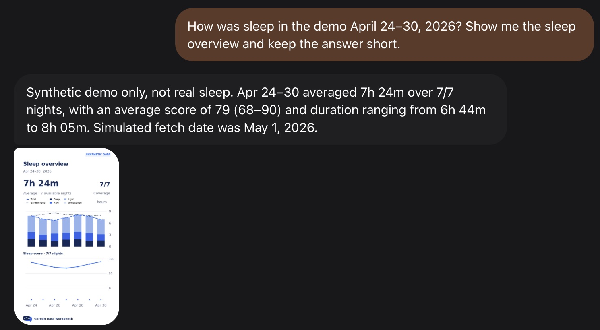
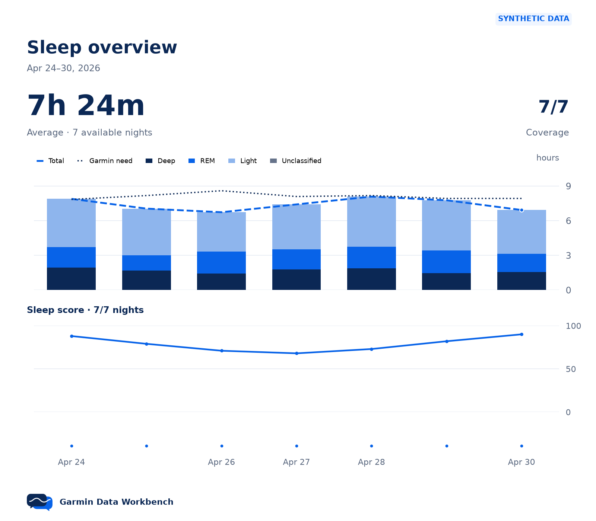

```text
  G A R M I N   D A T A

  __      _____  ___ _  _____ ___ _  _  ___ _  _
  \ \    / / _ \| _ \ |/ / _ ) __| \| |/ __| || |
   \ \/\/ / (_) |   / ' <| _ \ _|| .` | (__| __ |
    \_/\_/ \___/|_|_\_|\_\___/___|_|\_|\___|_||_|
```

# Garmin Data Workbench


[](https://www.python.org/)
[](https://github.com/0xBreadguy/garmin-data-workbench/releases/tag/v0.1.0)
[](https://github.com/0xBreadguy/garmin-data-workbench/actions/workflows/tests.yml)
[](https://www.sqlite.org/)
[](LICENSE)

**Your Garmin data, ready for your agent or your own analysis.**

Sync health data and activities into a SQLite archive on your computer or a persistent remote workstation. Keep the source JSON and original activity files. Ask your agent questions through MCP or the CLI, or work directly with SQL, scripts, notebooks and CSV.

- Review sleep, Body Battery, heart rate, steps and activities with dates, units and coverage.
- Compare two metric periods and review workout distance/duration totals by date and sport.
- Generate charts from the same stored data your agent queries.
- Explore native fields from all 26 documented Personal API endpoints and retain original activity files for your own analysis.

This is the early **[v0.1.0 release](https://github.com/0xBreadguy/garmin-data-workbench/releases/tag/v0.1.0)**. Read the [release notes](CHANGELOG.md), start with the synthetic demo or a short sync, and check the [tested hosts and assistant paths](docs/COMPATIBILITY.md) before relying on an integration.



A captured Muse conversation using generated demo data. The assistant reported using the CLI; this capture demonstrates visible answers and chart delivery. Appearance and connection options depend on your assistant. [Image provenance](assets/README.md).

## Get started

**Working with an agent?** Give it this repository and ask:

> Read AGENTS.md, then help me follow docs/SETUP.md on the workstation I choose.

**Setting it up yourself?** Install Python 3.12+ and [uv](https://docs.astral.sh/uv/), then:

```sh
git clone --branch v0.1.0 --depth 1 https://github.com/0xBreadguy/garmin-data-workbench.git
cd garmin-data-workbench
uv tool install --from . garmin-data-workbench
```

Follow the [setup guide](docs/SETUP.md) to create your Garmin Personal API key and run a first sync. Guided setup supports Codex and Claude Code; other agents can use local MCP or shell commands. Built-in scheduling supports macOS; remote workstations can use an OS scheduler or provider routine.

For charts, replace the install command with `uv tool install --from '.[charts]' garmin-data-workbench`.

This checks out the release tag. Contributors can clone the default branch using [CONTRIBUTING.md](CONTRIBUTING.md). Existing users should follow the [upgrade instructions](CHANGELOG.md#install-or-upgrade) and preserve their archive, configuration and schedules.

Keep your key out of chat. On a remote workstation, processes sharing your OS user can read credentials and health data. Query results may reach your agent's AI provider. Choose the host before syncing.

### Try it without a Garmin key

Follow the [isolated demo setup](docs/SETUP.md#mock-only-setup-stop-before-credentials) to generate synthetic data in a new archive, with its own checkout and environment. It makes no Garmin requests and preserves existing installations. An agent can start with:

> Read AGENTS.md and follow the mock-only route in docs/SETUP.md. Use a new checkout, environment and synthetic archive. Leave my existing installation, credentials, data and schedules unchanged. Show me the sleep overview for April 24–30, 2026.

## Use your archive

Ask your agent: “How did my sleep and resting heart rate change over the last week?” Or query it yourself:

```sh
garmin-archive status
garmin-archive day 2026-01-01
garmin-archive sleep --from 2026-01-01 --to 2026-01-07
garmin-archive trend sleep_duration --from 2026-01-01 --to 2026-01-07
```

Queries use stored data. Available history and fields depend on Garmin, your devices and what was recorded.



Example output from the [generated demo](docs/VISUALIZATION.md#try-generated-demo-data), not personal health data. Collection timestamps are simulated; wearable scores and stages are estimates.

## What works where

| Path | Current boundary |
| --- | --- |
| CLI and local archive | Offline CI covers macOS, Windows and Linux with Python 3.12. Live Windows credential/privacy validation is still incomplete. |
| Agents | Shell access or local stdio MCP. Codex and Claude Code have guided registration; each assistant connection needs its own query test. |
| Automatic sync | Built-in macOS scheduling. Other hosts need their own scheduler or provider routine. |

See [assistant connections](docs/ASSISTANTS.md) for remote access and the checks behind each compatibility claim. Garmin's Personal API is for individuals accessing their own data; review [Garmin's FAQ and terms](https://developer.garmin.com/gc-developer-program/personal/personal-faq/) before live setup.

## Go deeper

- [Commands, SQL, exports and scheduling](docs/USAGE.md)
- [Personal API source and field coverage](docs/API_COVERAGE.md)
- [Assistant connections and handoffs](docs/ASSISTANTS.md)
- [Contribute](CONTRIBUTING.md) · [Agent instructions](AGENTS.md) · [Testing](docs/TESTING.md)
- [Architecture](ARCHITECTURE.md) · [Security](SECURITY.md)

Found a problem? Open a [bug report](https://github.com/0xBreadguy/garmin-data-workbench/issues/new?template=bug-report.md) or [setup report](https://github.com/0xBreadguy/garmin-data-workbench/issues/new?template=setup-report.md) with a synthetic reproduction. Keep credentials, personal health data and routes out of public issues. Report vulnerabilities through [the security policy](SECURITY.md).

Independent open-source project. Not affiliated with, endorsed by, or supported by Garmin.
